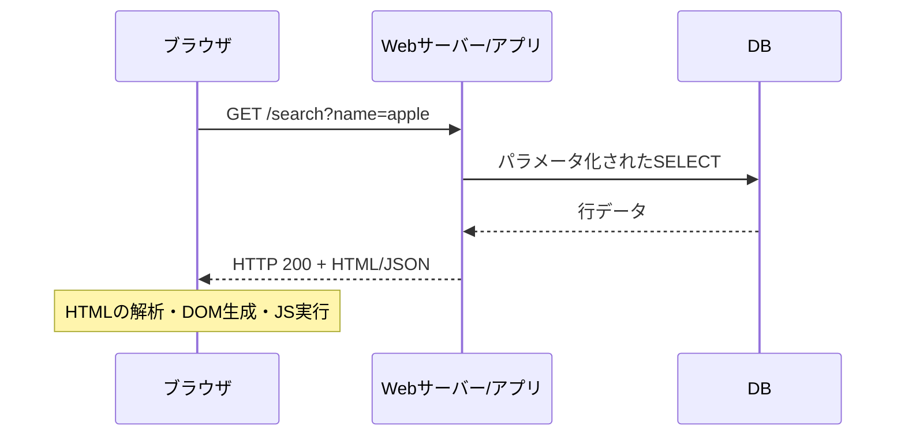

# 00｜HTTPと「データが命令になる」境界

## 最初に押さえる全体像



- **HTTPリクエスト**：メソッド、パス、クエリ、ヘッダー、Cookie、本文からなる。ブラウザの検索欄はGETとは限らず、POST、Fetch/XHRでも送れる。
- **HTTPレスポンス**：ステータス、ヘッダー、HTML/JSONなどの本文。サーバーは通常、クライアントのブラウザ上の「検証」表示を直接書き換えない。
- **ブラウザのDOM**：HTMLを解析したあとに作られる要素ツリー。JavaScriptはDOMを変更できるが、それは通常、オリジナルの「ページのソース」を書き換えることではない。
- **サーバー側の処理**：PHPはサーバー側、SQLはDB側、`exec()`を使う場合はサーバーOSのシェル、JavaScriptは通常ブラウザ側で解釈される。

## インジェクションの統一モデル

```text
信頼できない入力
   ↓
アプリが構文文字列の中へ直接混ぜる
   ↓
別の言語/解釈器（SQL・シェル・HTML・JS）が「命令」と認識
   ↓
意図しない実行・表示・データ操作
```

**共通の防御**：①命令と値を分離 ②出力先に合わせて符号化 ③入力の用途を制限 ④最小権限 ⑤エラーメッセージを過剰に公開しない。SQLiとXSSでは守る境界と方法が異なる。

## 記録すべき観測情報

| 項目 | 例 | 注意 |
|---|---|---|
| メソッド・パス | `GET /search` | ブラウザNetworkで実測 |
| 入力パラメータ | `name` | `-p name` のようにキーだけを指定 |
| 応答コード | 200/405/500 | 500だけでSQLi成立を断定しない |
| 応答差 | 真=複数、偽=検索失敗 | エラーと0件を区別する |
| 実行環境 | Werkzeug/Python等 | DBエンジンやPHP動作を即断しない |

**根拠**：[PortSwigger Burp HTTP history](https://portswigger.net/burp/documentation/desktop/tools/proxy/http-history)、[OWASP Injection Prevention](https://cheatsheetseries.owasp.org/cheatsheets/Injection_Prevention_Cheat_Sheet.html)。
