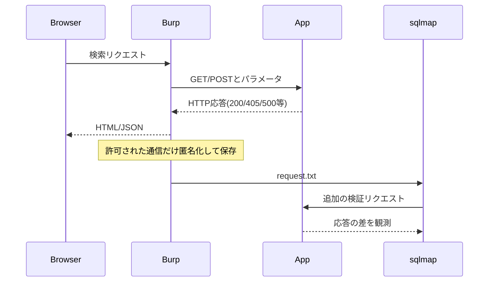

# 02｜Burp Suite → SQLmap — HTTPの再現と診断

## 役割の違い

- **Burp Proxy / HTTP history**：ブラウザとサーバーの間を観測し、HTTPリクエストとレスポンスの事実を保存。
- **Burp Repeater**：同じリクエストの入力だけを変え、応答を比較。
- **sqlmap**：許可された演習範囲でSQLiを検出・検証する自動化ツール。応答差・DB関数などを使うが、魔法のOS権限ではない。



## やり方（許可されたCTF限定）

1. ブラウザNetworkで実際の **Method/URL/Content-Type/Body** を確認。
2. Burp `Proxy > HTTP history` から該当リクエストを選び `Send to Repeater`。通常値・真・偽の差を見比べる。
3. Burpで元の**完全なリクエスト**をテキストへ保存。Cookie/CSRF等を保持する場合は厳重に管理（公開しない）。
4. sqlmapへ `-r` と `-p` を渡す。`--string` は実際のHTTPレスポンスにその文字列が存在するときだけ使う。
5. `--technique=B` はBoolean-basedに絞る。前回のCTFの方式がほかの演習でも同じとは限らない。
6. 確認済み結果をレポートし、修正後に応答差が消えたことをチェック。

### 読むための引数例（架空HTTPリクエスト）

```bash
# HTTPリクエストを保存済みの、許可された演習環境だけで使用
sqlmap -r request.txt -p name --technique=B \
  --string="複数" --batch -v 3
```

| 引数 | 説明 |
|---|---|
| `-r request.txt` | Burp保存のHTTPリクエスト |
| `-p name` | `name=` でなくパラメータキー `name` |
| `--technique=B` | Boolean-basedだけを検証 |
| `--string` | 真と見なす応答本文の目印。UI表示と別の場合に注意 |
| `--prefix`, `--suffix` | 特定SQL構造での境界指定。自動判定より適切なことを確認 |
| `--flush-session` | キャッシュしたセッションを消し検出をやり直す |
| `-v 3` | 詳細度を上げる（レベルにより表示内容が変わる） |

**注意**：`--batch`は自動で対話へ既定回答する。破壊的機能を含む操作では安易に使わない。

## 前回のCTFで学んだ論点（一般化）

- GETと想定していたが実際に405が出る → **個々のHTTPリクエスト**を確認。ステータスだけで原因を決めない。
- `AURORA_VERSION`など存在しない関数による500 → DBMS判別中のテスト由来の場合がある。**500 = 乗っ取り成功**ではない。
- 真が「複数」、偽が「検索失敗」 → 0件の結果とSQL例外が同じ表示になっていないかも検証。
- `Werkzeug/Python` はWeb層の情報。裏側のDBはMySQLという構成も普通にあり得る。

## 証拠の残し方

`templates/ctf-finding-template.md` を使用。個人情報を含まないようResponseの本文、Cookie、Authorizationヘッダー、URLの実IP、フラグを編集する。

**根拠**：[Burp HTTP history](https://portswigger.net/burp/documentation/desktop/tools/proxy/http-history)、[Burp Repeater](https://portswigger.net/burp/documentation/desktop/tools/repeater)、[sqlmap Usage](https://github.com/sqlmapproject/sqlmap/wiki/Usage)。
