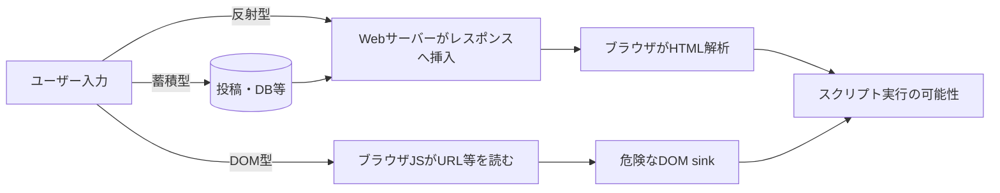

# 04｜XSS：反射型・蓄積型・DOM-basedを「入力→HTTP応答→JS」で理解

## 何が起きるのか

**ユーザーが入力した文字列を、ブラウザが意図しないHTML/JavaScriptとして解釈すると、サイトのオリジンでスクリプトが実行される可能性がある。** 入力の保存有無だけで脆弱性が決まるのではなく、「どの場面で危険な解釈をするか」が重要。



## 3種類を比較

| 種類 | 入力源 | 危険な処理 | 主な観測箇所 |
|---|---|---|---|
| 反射型（Reflected） | 検索欄、URL、エラー表示 | サーバーが安全にエスケープせずHTMLへ反射 | Network > Response |
| 蓄積型（Stored） | コメント、レビュー、プロフィール | 保存値が閲覧時にHTMLとして扱われる | 保存前後のResponse / 別セッション |
| DOM-based | `location.search`、`hash`等 | JSが入力を`innerHTML`等へ渡す | Sources / Elements / Console |

DOM-basedは反射/保存データと組み合わさることもあるため、排他的な分類とは限らない。

## HTTPとDOM（3番目の`<p>`を例に）

```html
<p>1番目</p>
<p>2番目</p>
<p id="third">3番目（書き換え前）</p>
```

```javascript
// 正規のページ内JavaScriptでDOMを変更する例
const element = document.querySelectorAll('p')[2];
if (element) element.textContent = 'CTF成功';

// IDがある場合
const byId = document.getElementById('third');
if (byId) byId.textContent = 'CTF成功';
```

- `[2]`は0起点の**3番目**（ページに別の`<p>`が前にあると対象もずれる）。
- `textContent`は**テキストとして**挿入する。`innerHTML`は**HTML構文として解析**するため、信頼できない文字列を入れてはいけない。
- このJSは**DOM**を書き換える。「ページのソースを表示」にあるオリジナルのHTTPレスポンスそのものは通常変わらない。
- `http://example.test/test.html?name=...` のURLに文字列を付けただけでは**コード実行は起きない**。サーバー反射またはJSの危険な取り込みが必要。

## 危険なデータ流れと安全な流れ

```javascript
// NG（信頼できない外部入力をHTMLとして解釈）
container.innerHTML = userInput;

// OK（単なるテキストとして表示）
container.textContent = userInput;
```

```php
// HTML本文へのテキスト表示としての基本形
print '<p>'.htmlspecialchars($input, ENT_QUOTES | ENT_SUBSTITUTE, 'UTF-8').'</p>';
```

HTML本文、属性、JavaScript文字列、URL、CSSでは**必要なエンコード・検証が異なる**。上記`htmlspecialchars`の例を、JavaScript文脈へそのまま適用して安全と判断しない。CSPやCookie属性は補助策であり、出力エンコーディングの代替ではない。

## CTFの着眼点（無害な検証から）

1. 一意なテキストで**入力の反射**を調べる。
2. Responseのどの文脈（本文/属性/JS/URL）にあるかを確認。
3. HTMLエンコードの有無、CSP、DOM sinkの有無を調べる。
4. 「編集したDOMだけ」か「ページをリロード・共有しても再現するか」を分ける。
5. メールで送るURLが課題のとき、**リンクの存在だけではXSS成立を証明しない**。ページ側の読み取り・解釈が必要。

## 原因と対策の一対一対応

| 原因 | 対策 |
|---|---|
| 動的HTMLに生の入力 | HTML文脈に応じて出力エンコード |
| `innerHTML` へ未検証値 | `textContent` 等の安全なsinkへ変更 |
| 任意HTMLを許容する要件 | 実績あるサニタイザー＋許可するタグ/属性の設計 |
| 保存値を無加工で再表示 | 表示時にエンコード。SQLi対策だけでは不足 |
| CSPなし | CSPを多層防御として導入（単独依存しない） |

**根拠**：[OWASP XSS Prevention](https://cheatsheetseries.owasp.org/cheatsheets/Cross_Site_Scripting_Prevention_Cheat_Sheet.html)、[PortSwigger XSS](https://portswigger.net/web-security/cross-site-scripting)、[DOM XSS](https://portswigger.net/web-security/cross-site-scripting/dom-based)。
