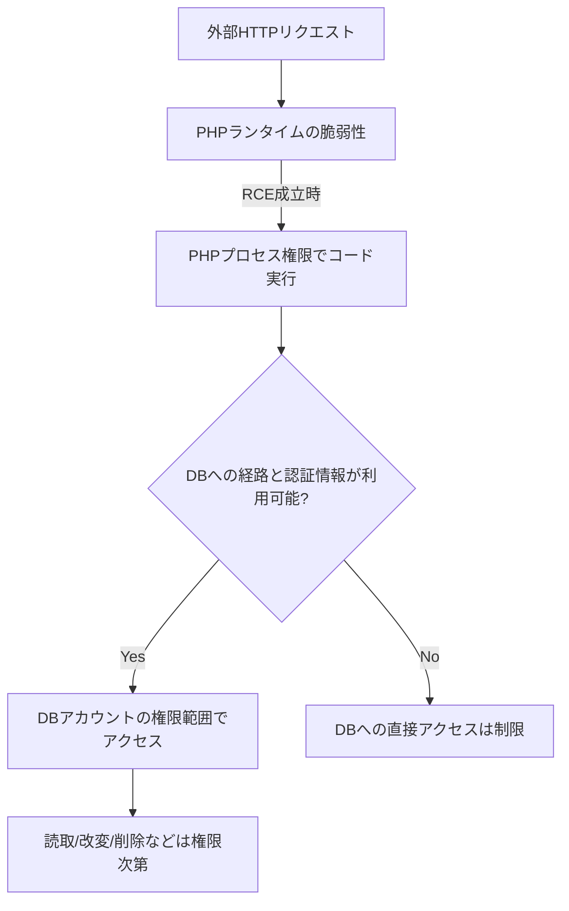

# 07｜PHP2Shell（2026年10月公開）とDBの関係

**基準日：2026-10-24**。脆弱性は新しく、利用製品ごとの影響範囲・実環境での成立条件は変わる可能性がある。必ず公式アドバイザリとベンダー情報を追う。

## 何が報告されたか（一次資料確認）

PHPプロジェクトは2026-10-21、次の2件を修正するセキュリティリリースを公開した。

| CVE | 公式説明の要点 |
|---|---|
| CVE-2026-109618 | OOM（メモリ不足）時の処理に関係するメモリ状態の不備 |
| CVE-2026-109619 | リクエスト間で残存した内部状態に関係する問題 |

状況次第で**認証前の遠隔コード実行（RCE）**につながる可能性がある。**これはMySQLのSQLiではなくPHPランタイムの脆弱性**。PDOの`prepare()`を正しく使っていても、ランタイムの欠陥には直接効果がない。

### PHP公式の2026-10-21修正版

| PHP系列 | 少なくともこの修正版へ更新 |
|---|---|
| 8.5 | 8.5.12 |
| 8.4 | 8.4.27 |
| 8.3 | 8.3.36 |
| 8.2 | 8.2.35（8.2系列は2026-12-31でサポート終了予定） |

**注意**：ディストリビューション・商用ベンダーは古いバージョン表記のまま修正パッチをバックポートする場合がある。`php -v`だけでなくパッケージのセキュリティ告知・SAPIの構成（CLI/Apache/PHP-FPM）も確認する。PHP公式は**完全な緩和策はなく修正版へ更新することが唯一の安全な選択**と案内している。

## DBへどう波及するか（条件付きシナリオ）

RCEが成立しても「必ずDBを自由に操作できる」とは言えない。ネットワーク到達性、秘密情報の保管方法、DBユーザー権限、コンテナ分離などが影響する。

## 防御の優先順位

1. **PHPランタイムの修正版を適用**し、アプリ・依存製品の互換テスト。
2. CLIとWeb実行系が同じPHPとは限らないため、Apache module・PHP-FPM・コンテナイメージを個別に棚卸し。
3. DB接続秘密情報とDB権限を見直し、不要な`FILE`・管理権限を撤去。
4. PHPプロセスとDBの間のネットワークを必要な通信に限定。
5. Webアクセスログ、アプリエラー、PHPワーカー異常終了、ファイル書き込みなどを相関分析。
6. WAF・リクエスト制限は補助であり、修正版の代替にしない。

## 「見つけたCVE」と「自分のサーバーで悪用可能」は別

CVEが該当するかは、バージョンだけでなく、SAPI、製品組み込み形態、構成、到達可能性を合わせて判断する。未検証の製品名・侵害事実を断定しない。

**一次資料**：[PHP公式 2026アーカイブ](https://www.php.net/archive/2026.php#2026-10-21-5)、[PHP GHSA CVE-2026-109618](https://github.com/php/php-src/security/advisories/GHSA-w8hw-w9fx-j79w)、[PHP GHSA CVE-2026-109619](https://github.com/php/php-src/security/advisories/GHSA-6wmf-4rv5-p3rp)、[IPA 2026-10-22](https://www.ipa.go.jp/security/security-alert/2026/alert20261022.html)。
