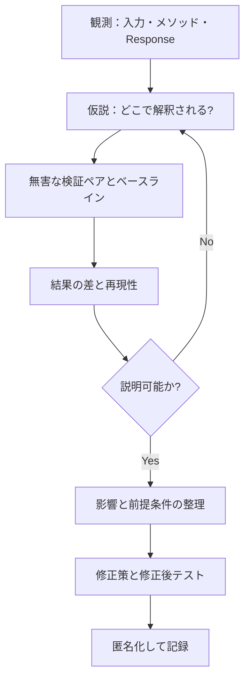

# 08｜CTF調査の方法論と「高難度CTF」

## 正しい調査の流れ

### よくある誤り

- `OR 1=2` は**元のWHERE条件も偽とは限らない**。入力した式だけの真偽で全体の検索件数を決めつけない。
- `No output` は実行失敗とは限らない。コマンドの標準出力とエラー出力の違い、出力回収失敗、権限等を切り分ける。
- `HTTP 500` はサーバーエラー。SQLi、PHP構文エラー、DB関数エラーなど原因が多数ある。
- `SHOW VARIABLES LIKE 'secure_file_priv'` で空欄に見えたら、**NULLと空文字列**を区別する。
- WebサーバーがPythonだからDBもPythonとは限らない。Web層・DB層・OS層の観測を別々に記録する。
- `querySelectorAll('p')[2]`はDOMの順番依存。対象の特定方法としてIDや安定したCSSセレクタが望ましい。

## 証拠の強度

| ラベル | 意味 | レポートでの書き方 |
|---|---|---|
| **観測** | 直接確認したHTTP本文、ログ、コマンド結果 | `HTTP 405が13回観測された` |
| **再現** | 条件を変えても同じ結果 | `真条件で複数、偽条件で検索失敗を繰り返し確認` |
| **推測** | 観測の説明として筋が通るが未検証 | `エラーが真偽判定に使われた可能性` |
| **仕様** | PHP/MySQL/OWASP公式の説明 | `PDOでは識別子をプレースホルダーにできない` |

## CTFの種類

- Webラボ：単独のSQLi、XSS、OSコマンド注入等から始め、複数の脆弱性や防御機構の組み合わせへ。
- インフラ/ボックス：Web・OS・ネットワーク・認証・権限の組み合わせ。
- Attack & Defense：脆弱性の調査と、自サービスのパッチ・稼働維持を同時に行う。
- Reverse / Pwn：バイナリ挙動やメモリ保護機構を理解する（Webとは別の専門領域）。

高難度と高セキュリティは同義ではない。簡単なバグでも環境によって悪用しにくく、高難度は単に観測が難しいこともある。

**演習先**：[PortSwigger Web Security Academy](https://portswigger.net/web-security)、[Hack The Box](https://www.hackthebox.com/hacker/hacking-labs)、[pwn.college](https://pwn.college/)。
