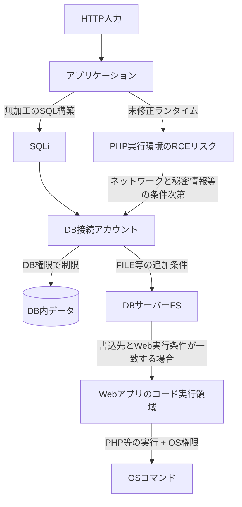

# 10｜攻撃連鎖と多層防御

## 単体の脆弱性と権限境界を分ける

「SQLiがあるからOSシェル確定」「RCEがあるからDB全部盗める」は誤り。**成立には各境界をまたぐ条件が必要**であり、そのどこかを防御すれば被害を限定できる。

## 各段階の防御コントロール

| 層 | 主なコントロール | 防ぐ/減らすもの |
|---|---|---|
| Webアプリ | バインド、入力と構造の分離 | SQLi |
| Web出力 | 文脈別エンコード、安全なDOM API、補助CSP | XSS |
| サーバー処理 | シェルを使わない専用API | OSコマンド注入 |
| PHPランタイム | 公式修正版・依存製品の更新 | 実行環境の既知のRCE |
| DB | アカウント別最小権限、不要なFILE権限削除 | DB・ファイル被害の広がり |
| OS/コンテナ | 最小権限、ファイルシステム分離 | 不要なファイル操作 |
| NW | DB通信元制限、セグメント設計 | 横方向へのアクセス |
| 運用 | ログ相関・異常検知・定期検証 | 発見と対応までの時間 |

## 監査するなら

検知だけでなく「パッチや設定変更後にもサービスが正常に動くか」を確認する。攻撃を再現する演習データと、実環境での監視ログや構成変更記録を区別する。

**根拠**：[OWASP SQLi](https://cheatsheetseries.owasp.org/cheatsheets/SQL_Injection_Prevention_Cheat_Sheet.html)、[OWASP OS Command](https://cheatsheetseries.owasp.org/cheatsheets/OS_Command_Injection_Defense_Cheat_Sheet.html)、[OWASP XSS](https://cheatsheetseries.owasp.org/cheatsheets/Cross_Site_Scripting_Prevention_Cheat_Sheet.html)、[PHP公式2026](https://www.php.net/archive/2026.php)。
