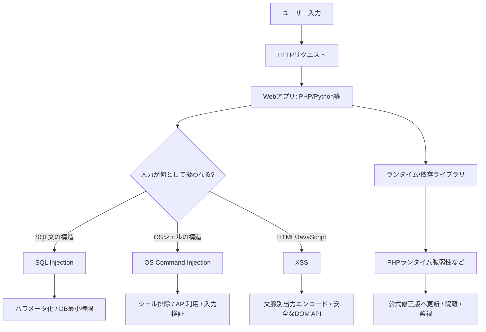

# Web Security Lab — 実戦ハンドブック（CTF版）

**手動攻略版更新：2026-10-24** | GitHubで読むMarkdown + Webで開く学習メニュー + ローカル演習

[**▶ クリック式のWeb学習メニューを開く**](index.html) · [**SQLi実戦マニュアル**](docs/01-sqli-ctf-field-manual.md) · [**ローカル演習**](lab/README.md) · [**一次資料一覧**](SOURCES.md)

> 既存 `security-web-lab` を壊さず、`security-handbook/` フォルダだけを追加できる構成です。既存READMEの目次は自動更新されないので、同梱 `README_APPEND.md` のリンクを追記してください。

## 手動攻略編（ツール不要で理屈を追う8章）

すべてローカル／許可CTFで、**入力→処理系→生HTTP応答→DOM/DB/OS→原因→修正→再テスト**を理解する構成。

| 章 | 内容とコマンド練習 |
|---|---|
| [18｜HTTPをコマンドで読む・再現する](docs/18-http-manual-curl.md) | HTTP・シェル・HTMLの意味を手で追って原因を切り分ける |
| [19｜OSコマンド注入・シェル文法](docs/19-os-command-manual.md) | HTTP・シェル・HTMLの意味を手で追って原因を切り分ける |
| [20｜XSSの文脈別・DOM手動検証](docs/20-xss-manual-contexts.md) | HTTP・シェル・HTMLの意味を手で追って原因を切り分ける |
| [21｜DIRB系の手動パス探索](docs/21-dirb-manual-discovery.md) | HTTP・シェル・HTMLの意味を手で追って原因を切り分ける |
| [22｜Burpの通信解析をコマンドで再現](docs/22-burp-without-burp.md) | HTTP・シェル・HTMLの意味を手で追って原因を切り分ける |
| [23｜CTF高難度対応・判断木](docs/23-ctf-tactics-decision-trees.md) | HTTP・シェル・HTMLの意味を手で追って原因を切り分ける |
| [24｜認証・認可・アップロード等](docs/24-other-web-ctf-reasoning.md) | HTTP・シェル・HTMLの意味を手で追って原因を切り分ける |
| [25｜手動CTF問題集・解説付き](docs/25-manual-drills.md) | HTTP・シェル・HTMLの意味を手で追って原因を切り分ける |

[**▶ 手動CTF・1枚早見表**](CTF_MANUAL_QUICKREF.md) ｜ [**▶ 演習問題**](docs/25-manual-drills.md)

**今回増えた演習**：DOM source/sink の脆弱版・安全版、HTTPパス探索(200/403/404)、HTTP応答の比較。`lab/server.py`は外部コマンド実行やファイル書込みを行わず、127.0.0.1に限定して起動する。

---

## 拡張した実戦マニュアル

| テーマ | 解説 | 実際にできること |
|---|---|---|
| SQLインジェクション | [CTFフィールドマニュアル](docs/01-sqli-ctf-field-manual.md) | 真偽、UNION、Error、Burp→sqlmap、エラー判定、修正確認 |
| XSS | [CTFフィールドマニュアル](docs/13-xss-ctf-field-manual.md) | 反射・蓄積・DOM、HTTP→DOM、3番目のp要素、対策 |
| OSコマンド | [実践ノート](docs/14-os-command-ctf-field-manual.md) | PHP DNS例、OSシェルとの境界、修正 |
| 認証・認可・CSRF・ファイル | [防御レビュー](docs/15-auth-access-csrf-file.md) | IDOR・権限、CSRF、アップロードの危険 |
| 監視・インシデント | [ログ/検知](docs/16-logging-incident-response.md) | エラー原因、証拠の残し方、検知 |
| 問題集 | [解説付き演習](docs/17-ctf-scenarios-and-answers.md) | ローカル課題と答え合わせ |
| 実行環境 | [Python標準ライブラリだけのローカルCTF](lab/README.md) | 脆弱/安全SQLiとXSSを比較 |

---

## 以前の基礎ノート（収録済み）

**更新基準日：2026-10-24 ｜ 言語：日本語 ｜ 公開用（実環境の秘密情報なし）**

CTFで学んだWeb攻撃の原理を、**HTTP通信 → 解釈される言語 → 脆弱性が生まれる境界 → 観測方法 → 対策 → 根拠**の順に整理した学習資料です。単なるコマンド集ではなく「なぜ成立するのか」を重視します。

> **使用条件**：自分で管理する検証環境、または明示的に許可されたCTFのみで実行してください。記載のホスト名、DB名、利用者名、認証情報は架空です。演習環境で得た実IP、Cookie、パスワード、フラグ、シェルファイル等は公開しません。

## 学習マップ

## 目次

| ファイル | 理解できること |
|---|---|
| [00｜HTTPと信頼境界](docs/00-http-trust-boundaries.md) | リクエスト/レスポンス、パーサー、インジェクションの共通原理 |
| [01｜SQLインジェクション](docs/01-sqli.md) | Boolean Blind / Error-based / UNION / 原因と防御 |
| [02｜BurpとSQLmap](docs/02-burp-sqlmap.md) | GET・POST、リクエスト保存、判定、エラーの読み方 |
| [03｜DBとファイルシステム](docs/03-mysql-files-os.md) | FILE権限、`secure_file_priv`、OSシェルとの境界、`find` |
| [04｜XSS](docs/04-xss.md) | 反射型・蓄積型・DOM型、`
`変更、`innerHTML`の危険性 |
| [05｜PHP PDO](docs/05-php-pdo.md) | `prepare()`、`:name1`、`bindValue()`、認可・権限制御 |
| [06｜OSコマンドインジェクション](docs/06-command-injection.md) | `exec(nslookup)`の危険、DNS専用API、ドメイン検証 |
| [07｜PHP2Shell 2026](docs/07-php2shell-2026.md) | ランタイム脆弱性とDB、影響条件、公式修正版 |
| [08｜CTF調査方法](docs/08-ctf-method.md) | 仮説→観測→結論、誤判定回避、上級CTFの考え方 |
| [09｜エラー辞典](docs/09-error-troubleshooting.md) | HTTP 405/500、DBエラー、No output、シェルの診断 |
| [10｜攻撃連鎖と多層防御](docs/10-attack-chain-defense.md) | SQLiから別の権限領域へ波及する条件と遮断ポイント |
| [11｜防御コードレビュー](docs/11-code-review.md) | 発見した脆弱性をどのコードで直すか |
| [12｜CTFケーススタディ](docs/12-case-study.md) | 実際の検証で何が分かり何が未検証なのか |
| [証拠・参考文献](SOURCES.md) | 公式一次資料、参照先と検証限界 |
| [公開前チェック](PUBLICATION_CHECKLIST.md) | 秘密情報・検証根拠・安全性のレビュー |

## 要点早見表

| 技術 | 根本原因 | 代表的な対策 | よくある誤解 |
|---|---|---|---|
| SQLi | 入力がSQL構造の一部になる | パラメータ化・識別子の許可リスト | `prepare`という文字があるだけで安全 |
| XSS | 信頼できない値が実行可能なHTML/JSとして扱われる | 出力文脈別エンコード・安全なDOM API | DB保存時のSQLi対策でXSSも防げる |
| OSコマンド注入 | 入力がシェル構造の一部になる | OSコマンドをやめて専用API | `$_GET`へ代入すれば安全 |
| PHPランタイム | アプリコード外の実行環境に欠陥 | 修正版の適用、被害縮小策 | `PDO::prepare()`でPHPエンジンのRCEも防げる |

## 手元で安全に確かめる

`examples/` に**防御実装だけ**を置きました。実行する場合もローカル/隔離環境で、PHP CLIおよび必要な拡張を確認してください。攻撃用Webシェルや実サーバーの抽出データは収録していません。

## GitHubへの追加

既存リポジトリのルートにこの `security-notes` フォルダを追加すれば、既存のREADMEや教材を上書きしません。GitHubのMarkdownとMermaidでそのまま閲覧できます。Git操作の例は [公開前チェック](PUBLICATION_CHECKLIST.md) に記載。

## 学習記録の位置づけ

過去の演習での表示（例：`Werkzeug/Python`、`name`パラメータ、`Boolean-based`、`No output`）は**観測例**です。全ての環境に当てはまる一般則ではありません。資料中の「観測」「推測」「公式仕様」を区別し、過剰な結論を出さないようにしています。
