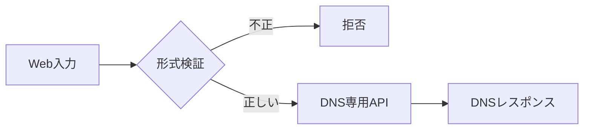

# OSコマンドインジェクション：調査・原因・安全実装

## 境界を正しく区別する

`$_GET['domain']` は入力の取得であり防御ではない。`exec('nslookup ' . $domain)` のような組み立てでは、文字列がシェルの解釈対象になる可能性がある。`filter_var()`は形式検証、`dns_get_record()`はシェルを呼ばないDNS APIであり、役割が全く違う。



## 主要な論点

| 手法 | 意味 | 危険の例 | 推奨対策 |
|---|---|---|---|
| `exec()` | OSコマンド呼び出し | 入力がコマンド構造に混入 | 専用APIへ置換 |
| `shell_exec()` | 標準出力を取得 | 実行結果のWeb公開・任意実行 | 必要なら固定コマンド、原則回避 |
| `FILTER_VALIDATE_DOMAIN` | ドメイン形式検証 | 形式が正しくても内部DNSを引ける | アクセス制限・レート制限 |
| `FILTER_FLAG_HOSTNAME` | ホスト名としての文字制限 | 文字だけでは到達先の安全性を保証しない | DNS・IP制御を併用 |
| `dns_get_record()` | DNSに問い合わせ | 内部DNSやリバインドなど周辺リスク | 制限、監視、出力時エスケープ |

### PHP安全例

```php
$domain = $_GET['domain'] ?? '';
if (!is_string($domain) || filter_var(
    $domain, FILTER_VALIDATE_DOMAIN, FILTER_FLAG_HOSTNAME
) === false) {
    http_response_code(400);
    exit('invalid domain');
}
$records = dns_get_record($domain, DNS_A | DNS_AAAA);
```

このコードは **OSシェルを使わない**点が重要。任意のドメイン問い合わせ自体を公開してよいかは別に検討する。

## CTFでの証拠

OSコマンド実行の証明、標準出力の取得、ファイルシステムのアクセス権限、WEBアプリの権限はそれぞれ別。`No output`だけで成功/失敗を確定しない。ローカル実習用の `lab/server.py` では **実OSコマンドを一切実行せず**、文字列連結を模した危険の仕組みと安全な代替を説明する。

## 根拠

- [OWASP OS Command Injection Defense](https://cheatsheetseries.owasp.org/cheatsheets/OS_Command_Injection_Defense_Cheat_Sheet.html)
- [PHP filter constants](https://www.php.net/manual/en/filter.constants.validation.php)
- [PHP DNS](https://www.php.net/manual/en/function.dns-get-record.php)
