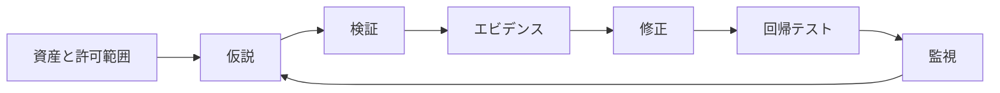

# CTFから実務へ：ログ・検知・インシデント対応

## 何を残す？

| レイヤー | 収集する項目 | なぜ必要 |
|---|---|---|
| Web/Proxy | 時刻、送信元（取り扱い注意）、Method、Path、status、サイズ | 405・500や集中アクセスを調べる |
| App | リクエストID、例外種別、失敗した入力検証 | エラーを公開せずに原因を特定 |
| DB | クエリエラー・実行時間・権限失敗 | SQLi・権限の異常を見つける |
| OS/Process | Webワーカーの異常終了・不審な子プロセス | RCEや障害の調査 |
| Network/IDS | DNS異常、許可外の通信 | コマンド実行や情報流出の兆候 |

**秘匿**：フルCookie・Authorization・パスワード・フラグをログへ無加工で残さない。個人情報や攻撃文字列の保持期間・閲覧権限も決める。

## 例：CTFでの事象判断

- **405** → URL/Methodを先に確認。DBの問題と断言しない。
- **500** → 例外内容とログ相関。DBエラー、未知の関数、アプリバグを分ける。
- **SQLmap Not injectable** → 未検出と報告。脆弱性ゼロの証明にしない。
- **`No output`** → シェルのstdout回収問題、権限、未実行を切り分ける。
- **HTTP応答にDBエラー詳細** → 原因の修正とともに情報漏洩経路を閉じる。

## 防御サイクル

## 根拠

- [OWASP Logging](https://cheatsheetseries.owasp.org/cheatsheets/Logging_Cheat_Sheet.html)
- [OWASP Error Handling](https://cheatsheetseries.owasp.org/cheatsheets/Error_Handling_Cheat_Sheet.html)
- [OWASP Incident Response](https://cheatsheetseries.owasp.org/cheatsheets/Incident_Response_Cheat_Sheet.html)
